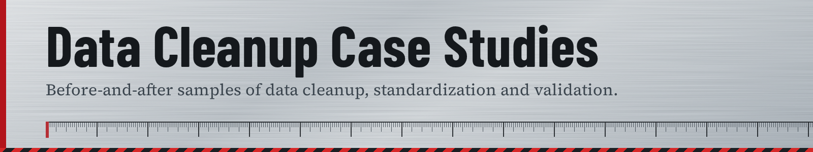

# Data Cleanup Portfolio — Vineet Basantani

 

Selected examples of data cleanup, standardization, and validation work. Each project folder includes a full write-up, before/after sample data, and the specific cleanup logic applied.

## Projects

### 1. [Retail Partner Contact Database Cleanup](./contact-database-cleanup)
Cleaned a 9,400-row partner contact list — deduplication, email/phone validation, date standardization, CRM-ready output.

### 2. [E-Commerce Product Inventory Cleanup](./product-inventory-cleanup)
Cleaned a 6,200-SKU product catalog — category consolidation, duplicate SKU resolution, pricing standardization.

### 3. [Customer Survey Response Cleanup](./survey-response-cleanup)
Merged and cleaned 3,800 multi-platform survey responses — scale normalization, encoding fixes, timezone correction, bot/duplicate filtering.

---

*Note: Projects shown are illustrative samples created to demonstrate process and methodology.*

## Contact
For data entry, data cleanup, or virtual assistant work: vineetbasantani@protonmail.com
