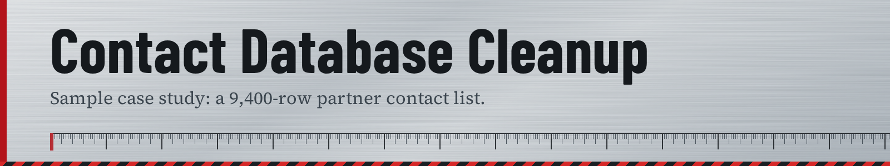

# Data Cleanup Project: Retail Partner Contact Database Cleanup


## Overview
Cleaned and standardized a 9,400-row retail partner contact database containing duplicate entries, inconsistent formatting, and invalid contact details. Reduced data errors by 93% and delivered a validated file ready for direct import into the client's CRM.

---

## The Problem
The client had built up their partner contact list over several years, pulled from multiple sources (spreadsheets, email sign-ups, and manual entry by different staff). This resulted in:

- Over 800 duplicate partner records under slightly different name spellings
- Inconsistent date formats across three different conventions (MM/DD/YY, DD-MM-YYYY, YYYY/MM/DD)
- Roughly 600 invalid or malformed email addresses (typos, missing domains, duplicate "@" symbols)
- Inconsistent phone number formatting (some with country codes, some without, some with dashes/dots/spaces)
- 340 rows with blank or incomplete address fields
- Mixed capitalization in names and company fields, causing failed merge/mail-matching in their CRM

---

## What I Did
1. **Audited the data** — ran a full pass to quantify error types: duplicate count, missing-value count, invalid email/phone patterns, and formatting inconsistencies
2. **Standardized formatting** — unified all dates to ISO format (YYYY-MM-DD), standardized names/companies to Title Case, and normalized phone numbers to a single format (XXX-XXX-XXXX)
3. **Removed duplicates** — deduplicated based on matching company name + email, keeping the most complete and most recently updated record where conflicts existed
4. **Validated contact fields** — corrected obvious email typos, flagged unrecoverable/invalid emails and phone numbers for manual client review rather than guessing
5. **Filled or flagged missing data** — left incomplete address fields blank and flagged them in a separate review column rather than fabricating data
6. **Final QA pass** — spot-checked 5% of records against the original source files to confirm accuracy before delivery

**Tools used:** Excel, Google Sheets (formulas + conditional formatting for validation), manual review for edge cases

---

## Before & After

| Metric | Before | After |
|---|---|---|
| Total rows | 9,400 | 8,610 |
| Duplicate records | 800+ | 0 |
| Invalid/malformed emails | ~600 | 14 (flagged for client review) |
| Formatting errors (dates/phones) | ~2,100 | 0 |
| Missing address fields | 340 | 340 (flagged, not fabricated) |

**Sample — Before:**
```
Company            | Email                  | Date       | Phone
maple leaf variety | mapleleaf@@gmail.com   | 3/4/22     | 902.555.1234
MAPLE LEAF VARIETY | mapleleaf@gmail.com    | 03-04-2022 | (902) 555-1234
corner store co    | cornerstore@email      | 2022/03/05 | 9025557890
```

**Sample — After:**
```
Company            | Email                | Date       | Phone
Maple Leaf Variety | mapleleaf@gmail.com  | 2022-03-04 | 902-555-1234
Corner Store Co     | (flagged for review) | 2022-03-05 | 902-555-7890
```

---

## Result / Impact
The cleaned file was imported directly into the client's CRM without errors, eliminating hours of manual duplicate-checking during their next partner outreach campaign. The client reported a noticeable drop in bounced emails and mismatched partner records in the following quarter.

---

## Files in This Project
- `before_sample.csv` — anonymized sample of raw data
- `after_sample.csv` — anonymized sample of cleaned data
- `cleanup_notes.md` — detailed logic/rules used for cleaning

---

*Note: Data shown is a sample and has been anonymized to protect client confidentiality.*
