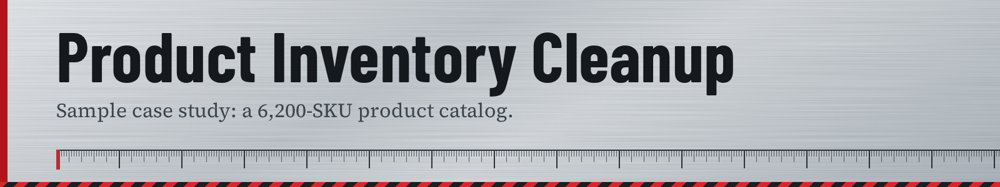

# Data Cleanup Project: E-Commerce Product Inventory Cleanup


## Overview
Cleaned and standardized a 6,200-SKU product inventory spreadsheet with inconsistent categorization, duplicate listings, and pricing errors. Consolidated the catalog into a single accurate source of truth, resolving over 500 duplicate SKUs and correcting pricing inconsistencies across the store.

---

## The Problem
The client's product catalog had grown organically across multiple bulk uploads and manual edits by different team members over two years, resulting in:

- 500+ duplicate SKUs listed under slightly different product names or capitalization
- Inconsistent category labels (e.g. "Home & Kitchen," "Home/Kitchen," "home-kitchen" all referring to the same category)
- Prices stored in mixed formats — some with currency symbols, some without, some including tax and some not
- Stock quantity fields left blank instead of "0," making it unclear whether an item was out of stock or simply never updated
- Inconsistent unit labeling (e.g. "12oz," "12 oz," "0.75lb" for what should be the same measurement standard)
- Several product titles containing leftover formatting artifacts from a prior CSV export (stray commas, escaped quotes)

---

## What I Did
1. **Audited the catalog** — quantified duplicate SKUs, inconsistent category labels, and pricing format variants before making changes
2. **Standardized categories** — built a mapping table to consolidate all category label variants into a single controlled taxonomy
3. **Cleaned pricing fields** — stripped currency symbols and stray characters, converted all prices to a consistent numeric format, and flagged listings where it was unclear if tax was included (rather than assuming)
4. **Resolved duplicate SKUs** — merged duplicate listings, keeping the most recently updated pricing/stock data and combining any variant info that had been split across duplicate rows
5. **Standardized stock fields** — distinguished genuinely out-of-stock items ("0") from items with missing/unverified stock data (flagged separately, not assumed to be zero)
6. **Fixed formatting artifacts** — cleaned up leftover export artifacts in product titles and descriptions
7. **Final QA pass** — cross-checked a random 5% sample of SKUs against the client's original supplier sheets to confirm accuracy

**Tools used:** Excel (VLOOKUP/XLOOKUP for category mapping, Power Query for deduplication), Google Sheets for client review pass

---

## Before & After

| Metric | Before | After |
|---|---|---|
| Total SKUs | 6,200 | 5,690 |
| Duplicate SKUs | 500+ | 0 |
| Distinct category labels | 47 (many redundant) | 14 (consolidated) |
| Price format errors | ~900 | 0 |
| Ambiguous stock fields | 380 blank | 380 flagged (0 assumed only where confirmed) |

**Sample — Before:**
```
SKU     | Product Title            | Category        | Price   | Stock
A1023   | "Ceramic Mug, 12oz,"     | Home & Kitchen  | $12.99  | 
a1023   | Ceramic Mug 12 oz        | home-kitchen    | 12.99   | 40
A1024   | Stainless Water Bottle   | Home/Kitchen    | 18      | 0
```

**Sample — After:**
```
SKU    | Product Title          | Category    | Price | Stock
A1023  | Ceramic Mug, 12oz      | Home & Kitchen | 12.99 | 40
A1024  | Stainless Water Bottle | Home & Kitchen | 18.00 | 0
```

---

## Result / Impact
The consolidated catalog eliminated duplicate listings on the client's storefront (which had been splitting review counts and sales data across near-identical SKUs), and standardized categories improved on-site filtering and search accuracy for customers.

---

## Files in This Project
- `before_sample.csv` — anonymized sample of raw inventory data
- `after_sample.csv` — anonymized sample of cleaned inventory data
- `cleanup_notes.md` — detailed logic/rules used for cleaning

---

*Note: This is an illustrative sample project created to demonstrate process and methodology — not an actual client engagement.*
